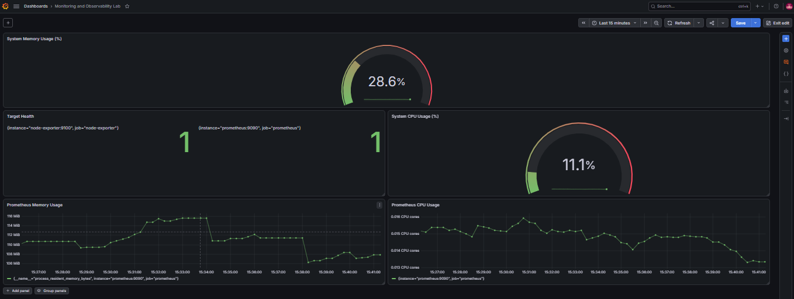

# Monitoring & Observability Lab

## Project Overview
This project demonstrates a basic monitoring and observability setup using Prometheus and Grafana. It provides visibility into target health, CPU usage, and memory usage through monitoring dashboards.

## Tools & Technologies
- **Docker Compose** — Runs the monitoring services
- **Prometheus** — Collects and stores metrics
- **Grafana** — Visualizes metrics through dashboards

## Architecture

Docker Compose runs the monitoring stack. Prometheus collects metrics from configured targets, and Grafana queries Prometheus to display monitoring dashboards.

## Features
- Target health monitoring
- CPU and memory utilization dashboards
- Prometheus metrics visualization
- Grafana dashboard for centralized monitoring
- Containerized deployment using Docker Compose

## Project Structure

```text
monitoring-observability-lab/
├── docker-compose.yml
├── prometheus.yml
├── grafana-dashboard.png
├── README.md
└── .gitignore
```

## How to Run

### Prerequisites
- Docker Desktop
- Git
- A web browser

### Start the Monitoring Stack

Run the following command from the project directory:

```bash
docker compose up -d
```

Check the running containers:

```bash
docker compose ps
```

### Access the Services

- **Grafana:** http://localhost:3000
- **Prometheus:** http://localhost:9090

The services and ports depend on your Docker Compose configuration.

## Dashboard Preview

The screenshot below shows the Grafana monitoring dashboard created for this project.



## Learning Outcomes
- Configuring Prometheus scrape targets
- Building Grafana dashboards
- Monitoring system CPU and memory metrics
- Verifying target health
- Running monitoring tools using Docker Compose

## Future Improvements
- Add alerting with Prometheus Alertmanager
- Configure additional application metrics
- Create more detailed operational dashboards
- Integrate infrastructure monitoring

## Author
**Suman Vishwakarma**

GitHub: [vishwakarmasuman](https://github.com/vishwakarmasuman)